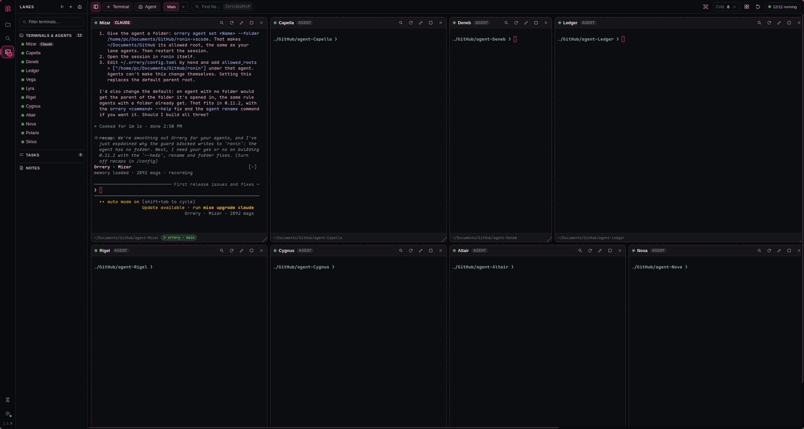
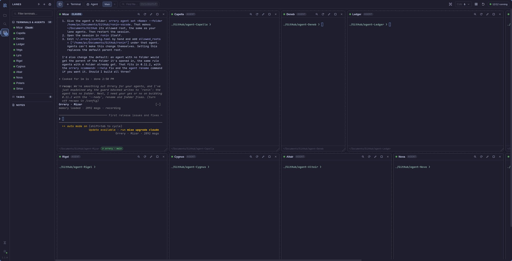

<p align="center">
  
</p>

<h1 align="center">Ronin</h1>

<p align="center">
  <b>Lightweight Rust + Tauri desktop workspace for running persistent terminals and AI coding agents in movable panels, with repo browsing, ripgrep search, and quick file previews.</b>
</p>

<p align="center">
  <a href="https://github.com/Tech0001/ronin/actions/workflows/ci.yml"></a>
  <a href="https://github.com/Tech0001/ronin/releases/latest"></a>
  <a href="LICENSE"></a>
</p>

<p align="center">
  
</p>

## Architecture

- **Split Rust binaries (`ronin` GUI + `ronin-daemon`):**
  - `ronin` (~4.3 MB): Slim Tauri 2 shell hosting the terminal canvas, sidebar, and file preview overlays.
  - `ronin-daemon` (~800 KB, ~3.5 MB RSS): Pure-Rust detached PTY daemon linking zero GTK/WebKit/Node libraries, using `portable-pty` + `vt100` screen/scrollback/mouse-encoding replay inside its own `systemd` user scope. Closing or restarting Ronin never kills running agents or drops scrollback.
- **Terminal Canvas:**
  - Auto-fit grid, themed `Auto`/`1–12` column picker, canvas tabs/pages, drag-to-reorder, manual resize, maximize/double-click header, `Start all` / `Run all`, duplicate lane, and persistent window geometry.
  - Keyboard pane switching (`Ctrl+Alt+Arrows`, `Ctrl+Alt+1–9`) and maximize (`Ctrl+Alt+M`), per-pane font zoom (`Ctrl+=`, `Ctrl+-`, `Ctrl+0`), in-terminal scrollback search (`Ctrl+Alt+F`), subtle `Ready` attention indicator, and per-pane display refresh.
  - Live git branch pills (direct `.git/HEAD` reads — zero `git` subprocesses) on Explorer roots and pane footers, with live `/proc` cwd tracking and an optional linked **Project repo folder** so agents running from separate folders (such as [Orrery](https://github.com/Tech0001/orrery) `agent-*` folders) still show their project's git branch and resolve relative file links.
  - Wrapped multi-line file links (`Ctrl+click` preview, `Ctrl+Shift+click` open externally), Pi-aware copy (`Ctrl+Shift+C` & right-click menu), Wayland-native clipboard (`wl-copy`/`wl-paste`), `Shift+Enter` (CSI-u), drag-and-drop file paths, and Ghostty-style solid selection.
- **Lightweight Sidebar (`Ctrl+Shift+B`):**
  - **Explorer (`Ctrl+Shift+E`):** Multi-root repo folders with live git branch badges, lazy tree, toggle dotfiles, drag file paths straight onto terminals, quick new-terminal-here.
  - **Search (`Ctrl+Shift+F`):** Ripgrep-powered workspace search with case (`Aa`), regex (`.*`), and glob filters.
  - **Lanes (`Ctrl+Shift+L`):** Terminal/agent overview across tabs, duplicate/start controls, quick tasks, and workspace notes.
  - **Quick Open (`Ctrl+Shift+P`):** Fuzzy file finder across all loaded folders.
- **Quick File Preview Overlay:** Line-numbered syntax-tinted code view with in-file search (`Ctrl+F`) and optional **Quick Edit** (`Ctrl+S` atomic save), sandboxed rendered/source **HTML** and **Markdown** preview, and zoom/pan **image** preview.

## Live Omarchy Theme Sync

Ronin watches `~/.local/state/omarchy/current/theme/colors.toml` and updates UI chrome, scrollbars, and every xterm pane live without restarting your terminals.

| Sakura Mochi | Catppuccin |
| :---: | :---: |
|  |  |

## Shortcuts

| Action | Shortcut |
| --- | --- |
| Toggle sidebar | `Ctrl+Shift+B` *(or `Ctrl+B` outside terminal)* |
| Explorer / Search / Lanes | `Ctrl+Shift+E` · `Ctrl+Shift+F` · `Ctrl+Shift+L` |
| Quick Open file | `Ctrl+Shift+P` *(or `Ctrl+P` outside terminal)* |
| Jump panes spatially / by index | `Ctrl+Alt+Arrows` · `Ctrl+Alt+1–9` |
| Maximize / restore active pane | `Ctrl+Alt+M` |
| Find in terminal scrollback | `Ctrl+Alt+F` |
| Per-pane font zoom / reset | `Ctrl+=` · `Ctrl+-` · `Ctrl+0` |
| Terminal copy / paste | `Ctrl+Shift+C` · `Ctrl+Shift+V` |
| Open file preview / external | `Ctrl+click` · `Ctrl+Shift+click` |
| Settings & daemon controls | `Ctrl+,` |

## Install from Release

Download from [GitHub Releases](https://github.com/Tech0001/ronin/releases):

- **Linux (Arch / Omarchy):**
  ```bash
  sudo pacman -U ronin-1.1.1-1-x86_64.pkg.tar.zst
  ```
- **Linux (Debian / Ubuntu):** install the `.deb` package, or use the portable tarball:
  ```bash
  tar -xzf ronin-1.1.1-linux-x86_64.tar.gz
  cd ronin-1.1.1-linux-x86_64
  ./install.sh
  ```
- **macOS (Apple Silicon & Intel):** open the `.dmg` and drag **Ronin** to Applications.
- **Windows (x64):** run the `.exe` (NSIS) or `.msi` installer.

## Build from Source

```bash
npm install
npm test
cargo test --workspace --manifest-path src-tauri/Cargo.toml

# Build optimized release binaries (ronin + ronin-daemon)
npm run build:release

# Package Linux .tar.gz + Arch .pkg.tar.zst into release/
npm run package:linux

# Or install directly to ~/.local/bin and ~/.local/share/applications
npm run install:linux
```

## Development

```bash
cargo build --manifest-path src-tauri/Cargo.toml -p ronin-daemon
npm run tauri dev
```
